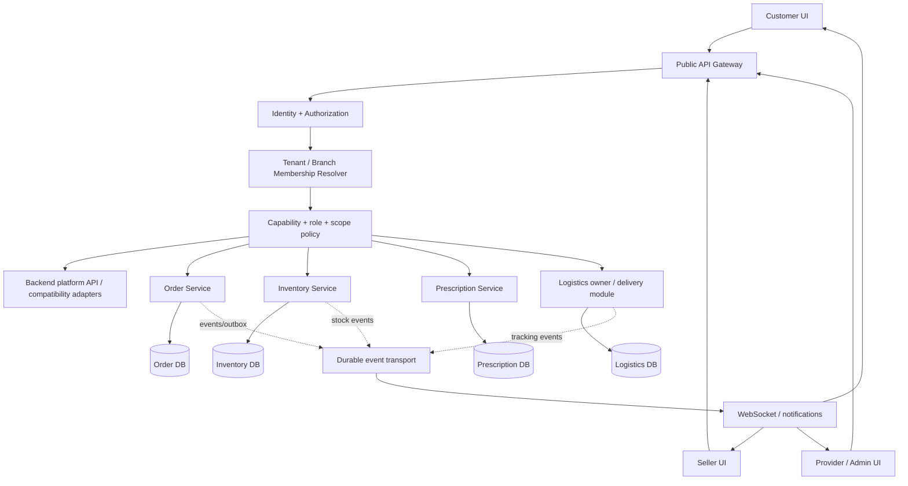
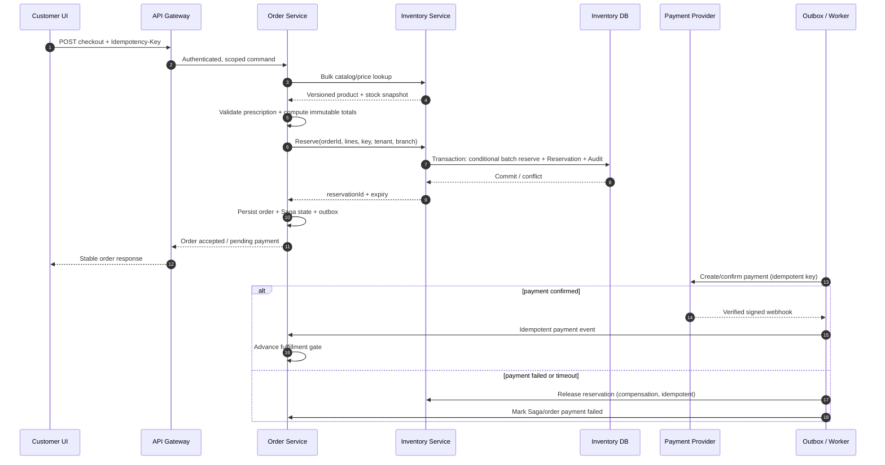
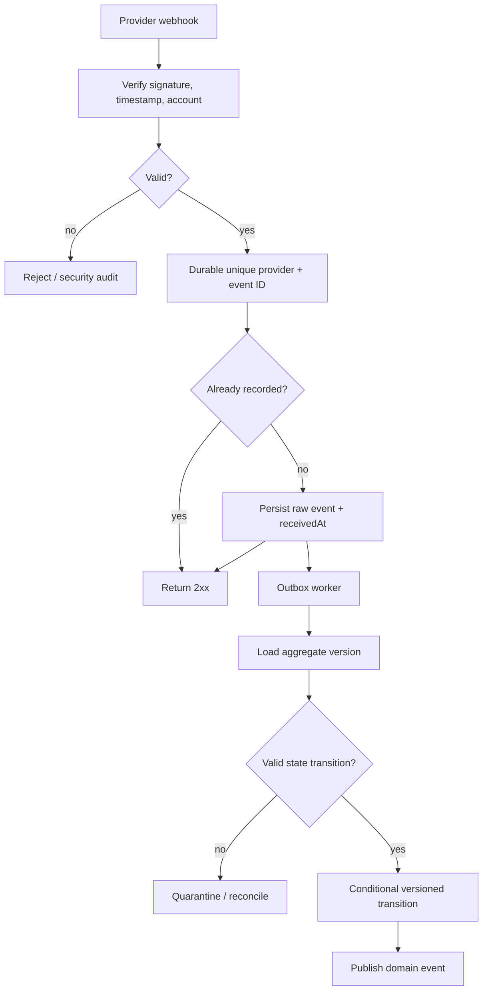
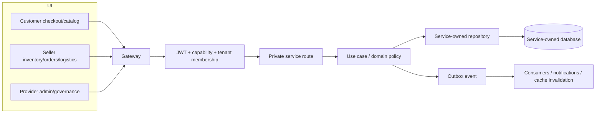

# Pharma Monorepo Segregation & End-to-End Flow Audit

**Repository:** `ashvins1912/Pharma`  
**Baseline:** `main` at audit time  
**Audit status:** Static source inspection; runtime timings, production query plans, load tests and payment-provider traces are not available from repository reads alone.

## 1. Executive findings

The repository is already an npm-workspaces monorepo, not a single undifferentiated application. It contains `frontend/`, `api-gateway/`, `backend/`, `services/*`, `apps/*`, and `packages/*`. Do not perform a destructive folder migration.

The canonical architecture in `AI_CONTEXT.md` is:
- Browser -> React/Vite frontend -> public API Gateway.
- Gateway -> private backend platform API, Inventory Service, Order Service, Prescription Service.
- Browser never calls internal services or MongoDB.
- Each domain service owns its data; one service must not write another service's database.

Existing strengths verified in code:
- Gateway service routing, trusted service tokens, browser request security and health monitoring.
- Inventory service has tenant/branch-scoped reads, MongoDB transactions for reservations, idempotency keys, reservation leases/expiry and audit records.
- Order service has request normalization/fingerprints, idempotency and fulfillment gates.
- Inventory catalogue search is aggregated in MongoDB before pagination rather than loading the entire catalogue into Node.
- Order DTO projections avoid returning internal reconciliation/idempotency fields.
- Delivery already has a domain module with ports, strategies, use-cases and an assignment engine.
- Shared algorithm and cache packages already exist.

Important constraints:
- Redis is not a declared dependency of the inspected inventory/order services or shared-cache package. A Redis Lua lease must not be assumed to exist or silently become a second source of truth.
- The existing inventory reservation is MongoDB-transaction based. Preserve it as the authoritative reservation record; a Redis lease can be an optional admission/coordination layer, never the stock ledger.
- The inspected order creation path performs a catalog lookup, computes immutable pricing snapshots, verifies prescription requirements, then requests inventory reservation. Do not move stock mutation into the order service.
- The current Order Service model contains order/payment status and event records, but the inspected files do not establish a complete payment gateway + wallet + split-settlement implementation. Payment/ledger complexity below is therefore an integration boundary, not a claim about measured implementation.
- No real latency measurements or runtime tests were executed during this static audit. Complexity is code-path analysis, not benchmark output.

## 2. Monorepo segregation strategy

### 2.1 Preserve the current top-level workspaces

| Workspace | Authoritative responsibility | Must not own |
|---|---|---|
| `frontend/` | Customer, seller and provider/admin UI; typed API clients; view state | Secrets, direct DB access, authoritative pricing/stock |
| `apps/shell-host/` | App shell and route composition | Domain persistence |
| `api-gateway/` | Public HTTP boundary, auth enforcement, capability checks, rate limits, routing, request IDs | Domain business rules or database writes |
| `backend/` | Identity, tenant/membership, platform administration, cross-domain orchestration and legacy adapters | Inventory/order/prescription canonical state |
| `services/inventory-service/` | Product/stock batches, reservations, imports, stock movements | Orders, payments or courier credentials |
| `services/order-service/` | Order lifecycle, immutable item/pricing snapshots, fulfillment gates, order events | Direct inventory writes or provider SDK calls |
| `services/prescription-service/` | Prescription documents, OCR jobs, pharmacist review and verification | Order/inventory canonical state |
| `services/admin-control-plane/` | Platform/provider governance, tenant operations and administrative workflows | Tenant business data writes outside owned APIs |
| `services/websocket-service/` | Authorized real-time event fanout | Source-of-truth writes |
| `services/caching-service(s)/` | Shared cache infrastructure only where actually deployed | Authoritative domain state |
| `packages/service-kernel/` | Errors, contracts and service primitives | App-specific business logic |
| `packages/database-kernel/` | Database connection/repository primitives | Cross-service data ownership |
| `packages/shared-cache/` | Cache interfaces/adapters and cache policy | Authoritative persistence |
| `packages/algorithm-kernel/` | Pure, deterministic algorithms and strategy interfaces | Network, DB or provider SDK side effects |
| `packages/shared-ui/`, `design-tokens/` | Reusable UI primitives and design system | Role-specific business policy |

### 2.2 Logical domain layout (incremental, not an immediate physical move)

Keep existing paths stable and introduce domain boundaries inside them. New modules should follow this pattern:

```text
frontend/src/
  app/                 # route shell, session and role-aware navigation
  features/customer/   # catalogue, cart, checkout, orders, prescriptions
  features/seller/     # tenant profile, branches, catalogue, inventory, orders,
                       # logistics connections, shipments, payouts
  features/provider/   # platform admin, tenant/provider governance, audit
  api/                 # gateway-only typed clients and DTO adapters

api-gateway/src/
  routes/              # public route composition
  policies/            # auth, capability, tenant/branch, idempotency, rate limit
  adapters/            # backend/service routing only

backend/
  identity/            # accounts, credentials, sessions, MFA
  tenancy/             # tenants, branches, memberships and policy resolution
  platform/            # platform administration and cross-domain orchestration
  adapters/            # compatibility adapters; migrate only after caller audit

services/
  inventory-service/src/{domain,application,infrastructure,http}/
  order-service/src/{domain,application,infrastructure,http}/
  logistics-service/src/{domain,application,infrastructure,providers,http}/
  payment-service/src/{domain,application,infrastructure,providers,http}/
  prescription-service/ # retain Python ownership
  admin-control-plane/  # provider/platform governance

packages/
  contracts/           # versioned API/event schemas, generated TS types
  algorithm-kernel/    # pure TOPSIS, bandit, retry, bloom, LRU-K algorithms
  service-kernel/
  database-kernel/
  shared-cache/
  shared-ui/
```

Create `logistics-service` and `payment-service` only when their owning responsibilities are moved with explicit gateway adapters and tests. Until then, keep the current delivery module and payment routes as the compatibility owners. Do not create duplicate controllers or duplicate models.

### 2.3 Customer, Seller and Provider request-to-data flow



Rules:
1. UI sends business intent and an idempotency key; it never supplies trusted user, role, tenant, branch, permission or PUID context.
2. Gateway authenticates, derives authorization context and routes only to private services.
3. Each service re-validates signed service identity and tenant/branch scope.
4. The owning service writes its own DB. Cross-service changes use idempotent commands/events and Saga compensation, not cross-database writes.
5. Provider credentials are tenant-owned secrets encrypted at rest; they are never returned to browser DTOs or logs.

## 3. Flow discovery and bottleneck matrix

Complexity variables: (K)=cart line count (bounded at 100 in inspected APIs), (B)=eligible stock batches for a SKU, (P)=catalogue products, (E)=events, (R)=eligible courier providers. These are asymptotic estimates from inspected source, not measured latency.

| Pipeline | Observed path / current work | Time & space analysis | Main bottleneck / risk | Priority |
|---|---|---|---|---|
| Checkout & pricing | Order Service normalizes/deduplicates lines, calls Inventory bulk lookup, snapshots price/product fields, verifies prescription, then reserves inventory | Request normalization (O(K)) time/space; catalog result map (O(K)); reservation work currently includes per-line candidate queries, approximately (O(K + sum B_i)) DB work plus network latency | Serial service calls; price may change between lookup and reservation unless version/price is revalidated; retry after timeout needs stable idempotency key | P0 |
| Inventory reservation | Inventory Service checks idempotency, opens Mongo session/transaction, reads tenant products, then loops lines and reads eligible batches; writes allocation reservation and audit in transaction | (O(K + sum B_i)) application work; DB round trips grow with line count due per-item candidate lookup; allocation arrays (O(K+sum B_i)) | Transaction contention on hot batch rows; concurrent same-key race is guarded by unique key; unique-key replay path exists; need contention tests and deterministic allocation ordering | P0 |
| Order creation | Order Service checks existing order, catalog lookup, pricing snapshot, prescription verification, inventory reservation, then persists order/event | (O(K)) local work + external calls; latency approximately sum of dependent network calls | Sequential dependencies; inventory reservation may succeed while order persistence fails unless compensation/reconciliation is guaranteed; inspect complete function before changing ordering | P0 |
| Payment & ledger | Order model has paymentStatus/amountPaid and order event records; backend exposes payment routes. Full provider intent, webhook verification and wallet split flow not proven by inspected files | For (E) webhook deliveries, idempotent processing should be (O(1)) average key lookup per event; ledger posting must be transactionally unique | Provider duplicate/out-of-order webhook, amount/currency/merchant mismatch, partial payout, retry-after-timeout. Requires dedicated source trace before refactor | P0 audit gap |
| Fulfillment & logistics | Existing backend delivery module has assignment engine and strategies; order owns fulfillment gate and rider snapshot; logistics provider aggregation not confirmed in inspected source | Rule selection typically (O(R)); TOPSIS scoring (O(RC)) for (C) criteria; bandit update (O(1)) per feedback | Static ranking may not reflect live provider performance; assignment races need conditional state transition/lease; AWB and manifest calls need idempotency | P1 |
| Tracking DAG | Order events use unique eventKey and status; provider tracking ingestion path still requires full audit | (O(E)) event history; DAG transition validation (O(1)) per edge with indexed current state | Out-of-order carrier scans; event timestamp vs received timestamp; duplicate webhook; terminal-state regression | P1 |
| Catalog search/feed | Inventory search filters/aggregates in Mongo before pagination; indexes exist for tenant/active/category/name and branch/product/expiry | Indexed query roughly (O(log P + pageSize)) for selective filters; aggregation and sort depend on selectivity/index coverage; memory bounded by page/aggregation plan | Offset pagination cost grows with page depth; count/aggregate and joins may dominate; cursor pagination should be added compatibly | P1 |
| Cache/sync | Shared-cache and algorithm-kernel packages exist; cache invalidation/event contracts need exact caller audit | Cache hit (O(1)) average; full sync (O(P)); hash diff (O(P)) build, (O(Delta)) transfer | Invalidation races/stampede; no claim that Redis/LRU-K is currently wired into each service | P2 |

### 3.1 Concrete code findings

- `services/inventory-service/src/inventory.js`: `reserveInventory` performs a Mongo transaction, product lookup and then an awaited Inventory candidate query inside the per-item loop. This is a clear DB round-trip hotspot for multi-line carts.
- The same function allocates batches in expiry order and writes Reservation + Audit in the same transaction. Keep this atomic boundary.
- `services/inventory-service/src/models.js`: reservation idempotency key is unique; inventory has tenant/branch/product/batch unique index and expiry lookup index.
- `services/order-service/src/orders.js`: `createOrder` has a serial catalog lookup, price snapshot, prescription verification and inventory service call. It already uses request idempotency/fingerprint logic; preserve it.
- `services/order-service/src/models.js`: order has unique orderNumber, source/idempotency and externalReference indexes, tenant/branch list index, version, fulfillment gate and event uniqueness.
- `api-gateway/src/server.js`: public gateway authenticates, applies browser request security, resolves capability and routes to private services. Do not bypass this boundary.
- `backend/server.js`: backend still mounts many legacy/platform routes. Keep adapters until route ownership/callers are proven migrated.
- `packages/algorithm-kernel` and `packages/shared-cache` already exist; extend them rather than creating a competing algorithm/cache package.
- Root `package.json` declares workspaces, but has duplicate `dev` keys (the later key wins in JSON parsing) and duplicate script concerns; fix separately with a regression-tested package script change, not as part of a business-flow refactor.

## 4. Hybrid algorithm blueprint

### A. Carrier routing: TOPSIS + epsilon-greedy bandit

For eligible carrier (r), build a normalized decision matrix over cost, ETA/SLA, distance, seller preference and serviceability. Apply criterion weights and TOPSIS ideal/anti-ideal distance to produce deterministic score (T_r in [0,1]). The exploration policy chooses a carrier randomly with probability (epsilon); otherwise chooses the highest (T_r) adjusted by a bounded learned reliability factor. Update reward only from verified delivery outcomes (delivery success, on-time, RTO, damage), not from assignment or pickup alone.

Guardrails:
- Hard constraints (pincode serviceability, COD support, package limits, regulated goods, seller contract) filter candidates before scoring.
- Per-tenant and per-lane statistics; Bayesian smoothing/minimum sample size; epsilon floor and max exploration budget.
- Never let the bandit override compliance or hard SLA exclusions.
- Store model version and decision explanation for every assignment.
- Feedback is delayed; use shipment cohort and provider event deduplication.

### B. Inventory admission: token bucket + atomic lease + Mongo transaction + Saga

Use token bucket at gateway to shed abusive bursts per tenant/user/IP. A short Redis Lua lease may reserve admission capacity for hot SKUs using atomic compare-and-set and TTL, but Mongo Inventory Service remains the only authoritative stock ledger. Mongo transaction conditionally increments `reservedQuantity` only when `stockQuantity - reservedQuantity >= requested`, writes Reservation and Audit atomically. A durable order Saga coordinates reservation, payment and AWB; every step has an idempotency key and compensation.

Critical correction to the task proposal: a Redis TTL lease alone cannot guarantee no oversell because expiry, process pauses and Redis failover can outlive assumptions. Use fencing tokens/lease version and final conditional Mongo write; do not deduct stock based only on Redis state.

### C. Webhook/API resilience: idempotency store + Bloom prefilter + sliding breaker + decorrelated jitter

A Bloom filter is only a probabilistic prefilter: a positive result must be confirmed against durable idempotency storage; a false positive must never drop a legitimate webhook. Durable unique event key/provider event ID is authoritative. Use a bounded sliding-window circuit breaker per provider operation and decorrelated-jitter retries for transient failures only. Never retry non-idempotent side effects without an idempotency token. Persist inbound event before acknowledging provider webhook; process from outbox/queue.

### D. Sync/cache: content hash delta + LRU-K + single-flight

Build stable canonical hashes for versioned catalog entities; send changed IDs/fields plus tombstones and cursor, not whole catalog snapshots. L1 process cache is bounded LRU-K; L2 Redis is optional distributed cache. Use single-flight per cache key and versioned invalidation events. Cache is disposable; DB remains source of truth.

## 5. Transaction sequences

### 5.1 Checkout / inventory / order Saga



Atomicity boundary: Inventory reservation + inventory audit in one Inventory DB transaction; Order + order event/outbox in one Order DB transaction. There is no cross-service ACID transaction.

### 5.2 Webhook ingress and event ordering



### 5.3 UI -> API -> DB ownership



## 6. Implementation order and acceptance criteria

1. **P0: Checkout/inventory** — remove per-item candidate query round trips with one scoped batch fetch; allocate in memory deterministically; retain conditional stock updates, transaction, reservation uniqueness and audit. Add same-key replay, concurrent last-unit, partial multi-batch, transaction abort and tenant-isolation tests.
2. **P0: Webhook engine** — first map actual payment and courier webhook endpoints and provider event schemas. Add durable provider-event idempotency, signature verification, outbox, transition version checks and bounded retries. Bloom filter is optional optimization only after durable correctness exists.
3. **P1: Carrier selection** — adapt the existing delivery strategy/assignment engine behind a carrier strategy port; add TOPSIS scoring and epsilon-greedy feedback store; hard constraints remain authoritative. Add deterministic unit tests and simulation before enabling exploration in production.
4. **P1: Search/cache** — add cursor pagination with backward-compatible page adapter; benchmark query plans; introduce versioned hash delta and L1/L2 single-flight only where the current cache callers justify it.
5. **P2: physical monorepo moves** — only after import/caller maps and deployment manifests are updated together.

Acceptance gates:
- No browser-to-service direct calls and no browser-to-DB paths.
- Tenant/branch derived from verified identity, never request payload.
- No duplicate stock reservation under concurrent same-SKU requests.
- No payment or courier webhook can regress terminal state or double-post a ledger entry.
- Each external side effect is idempotent and auditable.
- Public API response shape remains compatible or is versioned.
- CI runs workspace tests, tenant-isolation tests, concurrency tests, build and lint.
- Load tests report p50/p95/p99, DB round trips, lock wait, cache hit ratio and provider error rates; no latency improvement is claimed without before/after measurements.

## 7. Known audit limits / next source traces required

The following need a second pass against exact callers and provider integrations before production refactoring:
- Full payment intent, webhook signature, wallet ledger and split payout implementation across backend routes/services.
- Existing carrier credential storage, provider adapter registry, AWB/manifest/tracking event handlers and seller UI pages.
- Cache package call sites, invalidation ownership, Redis deployment availability and TTL policies.
- MongoDB query explain plans and replica-set transaction configuration.
- Existing CI result and runtime concurrency/load-test baselines.

This report is an evidence-based static audit and architecture blueprint. It is not a claim that these runtime gates have passed.


## 8. Changes made on this audit branch

- Added this architecture/flow audit and segregation strategy.
- Updated `services/inventory-service/src/inventory.js` so reservation candidate batches for all cart products are fetched in one tenant/branch-scoped query and grouped in memory. The existing MongoDB transaction, FEFO allocation order, conditional `reservedQuantity` increment, reservation idempotency, Reservation write and Audit write are retained.
- Expected query-shape improvement: candidate-read round trips change from one query per cart line ((O(K)) candidate reads) to one batched candidate query ((O(1)) candidate reads), while conditional writes remain per allocated batch. This is a reduction in DB round trips, not a claim of measured latency improvement.
- Tests have not been executed in this environment. CI must run the inventory-service and root workspace suites before merge. A concurrent last-unit test and a multi-line FEFO allocation regression test should be required before enabling this change in production.
- Carrier TOPSIS/bandit, Redis Lua leases, webhook Bloom prefilter/circuit breaker, payment ledger Saga and LRU-K/Merkle sync are specified above but are **not yet implemented**. They require their actual provider/storage call sites and deployment contracts to be traced before safely wiring them in.


## 9. Follow-on implementation added to this branch

The initial audit branch has now been extended with additional reusable code:

### Inventory reservation correctness
- Reservation idempotency is now unique by `tenantId + branchId + idempotencyKey`, rather than globally unique by caller key. This prevents unrelated sellers from colliding when clients reuse common idempotency keys.
- Added an explicit migration script: `npm --workspace services/inventory-service run migrate:reservation-idempotency-index`. It creates the scoped compound unique index before dropping the legacy global index. Run it against the Inventory database during a controlled deployment window.
- Added replica-set integration coverage for two tenants reusing the same key and eight concurrent attempts to reserve a single remaining unit. This test is part of `inventory-batch.integration.test.js` and is enabled by `INVENTORY_TEST_MONGO_URI`.

### Adaptive carrier selection kernel
- Added a pure TOPSIS scorer and epsilon-greedy selector to `packages/algorithm-kernel/src/logistics/carrier-selection.js`, with unit tests.
- Hard serviceability exclusion is applied before scoring. The bandit consumes verified delivery outcomes and does not override compliance or serviceability.
- This is a reusable algorithm kernel, not yet wired to a persistent per-tenant/per-lane performance repository or an external shipping provider adapter. Bandit state is currently in process memory; production use requires durable outcome statistics and model-version audit.

### Two-tier cache primitives
- Added `LruKCache`, `SingleFlight` and `TieredCache` to `packages/shared-cache/index.js`, with unit tests.
- L1 is bounded and TTL-aware; L2 uses the existing SharedCacheClient when configured; source reads are coalesced; cache failures fall back to the source; invalidation clears both tiers best-effort.
- These are composable primitives. Domain cache keys, durable versioned invalidation events and service-by-service adoption still need integration.

### Verification
- Root `npm test` now includes `packages/algorithm-kernel` tests.
- GitHub Actions workflow `Tenant security regression` runs inventory integration tests against a MongoDB replica set, then frontend build/lint and the root regression suite.
- At the time of this update, the workflow run associated with an earlier branch commit was still in progress. Do not treat it as a pass until the latest branch commit has a completed green run.

## 10. Remaining production integration work (not claimed complete)

1. Payment gateway provider adapters, payment-intent creation, durable webhook ingress, wallet accounts, double-entry ledger, split settlement and payout reconciliation.
2. Logistics provider connection CRUD, encrypted seller credential storage, Shiprocket/Delhivery and further direct/aggregator adapters, quote/booking/AWB/manifest/label/tracking/NDR/returns APIs, seller UI and provider webhook ingress.
3. Persisted bandit statistics per tenant/lane/provider and integration of the hybrid selector into shipment booking.
4. Apply TieredCache to selected catalogue/feed/read paths with explicit cache version and outbox-driven invalidation.
5. Customer/seller/provider UI-to-API-to-database Playwright flows and service contract tests.
6. Run concurrency/load tests and publish before/after p50/p95/p99, DB round-trip counts, lock waits, error rates and cache hit rates.
